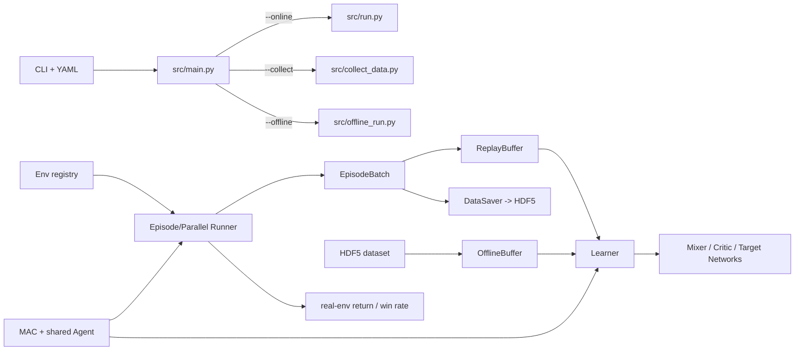

# OffPyMARL Baseline 复现研究笔记

> 文档性质：持续更新的项目级知识库，而不是一次性 README 摘要。  
> 当前状态：已完成框架静态梳理、依赖环境核验、注册表导入与全部算法配置的构造级 smoke check；尚未进行数据集训练或真实环境 rollout。  
> 最近更新：2026-08-28。

## 0. 记录原则

后续每次围绕 baseline 的实质性询问、代码核验、实验或结论，都同步更新本文件。记录时遵守以下规则：

1. 区分三类结论：
   - **代码确认**：可由当前 commit 的 active code path 直接证明。
   - **实验确认**：有命令、配置、seed、日志与 artifact 支撑。
   - **待验证假设**：静态阅读发现的风险或论文一致性疑问，不提前当作结论。
2. 区分三个成功层级：
   - **软件正确性**：能构造、能完成 update、无 shape/NaN/mask 错误。
   - **论文一致性**：目标函数、信息边界、target update、数据处理和论文/官方实现一致。
   - **研究有效性**：完整数据训练后，在真实环境 rollout 中获得可重复的 return/win rate；测试通过或 training loss 下降不等于复现成功。
3. 已被新证据推翻的结论不直接删除，标注“已废弃/被替代”，并链接到新证据。
4. 所有实验至少记录：代码 commit、dirty state、数据集、环境版本、完整配置、seed、命令、指标和输出路径。

## 1. 当前研究快照

| 项目 | 当前值 | 证据状态 |
| --- | --- | --- |
| 仓库 | `https://github.com/1otuses/offline-marl-framework-offpymarl.git` | Git 本地配置确认 |
| 分支 / commit | `main` / `1a08204a53e07a2870060a7bf3c49305db23e6c6` | Git 确认 |
| 工作树 | `install_smac.sh` 存在任务开始前的用户修改，必须保留 | Git 确认 |
| 推荐环境 | Conda `offpymarl`，Python 3.10.20 | 实机确认 |
| 核心依赖 | PyTorch 2.1.1+cu121、PyYAML 5.4.1、h5py 3.8.0、Sacred 0.8.4、Gym 0.21.0 | 实机导入确认 |
| SMAC Python 包 | 当前仓库 `3rdparty/smac/smac` | 实机导入确认 |
| StarCraft II | `3rdparty/StarCraftII` 当前不存在 | 文件系统确认 |
| 离线数据 | 根目录 `dataset/` 当前不存在 | 文件系统确认 |
| 结果目录 | 根目录 `results/` 当前不存在，首次运行时创建 | 文件系统确认 |
| 当前验证上限 | 12 个 learner、3 个 controller、2 个 runner、2 个 env adapter 均可导入；16 个算法 YAML 均可完成对象构造 | 构造级 smoke check |

当前不能声称任何 baseline 已经训练成功或达到论文性能：数据集和 SC2 runtime 尚未就位，且尚未执行 learner update、checkpoint round-trip 或真实环境评估。

## 2. 一句话理解整体框架

这是一个以 PyMARL 为骨架的、面向离散动作 Cooperative MARL 的配置驱动框架：在线 rollout、离线数据采集和离线训练共享 `Env -> Runner -> EpisodeBatch -> MAC -> Learner` 接口，离线训练仅把在线 `ReplayBuffer` 换成从 HDF5 读取整回合轨迹的 `OfflineBuffer`，同时继续用真实环境 runner 做周期性评估。



## 3. 入口、配置与注册表

### 3.1 唯一入口和三种运行模式

入口是 [`src/main.py`](src/main.py)。第一个不含 `=` 的 `--xxx` 参数被解析为 `run_file`：

| 模式 | 分发文件 | 主要职责 |
| --- | --- | --- |
| `--online` | [`src/run.py`](src/run.py) | 在线采样、ReplayBuffer 训练和周期评估 |
| `--collect` | [`src/collect_data.py`](src/collect_data.py) | 训练/加载行为策略并把整回合轨迹保存为 HDF5 |
| `--offline` | [`src/offline_run.py`](src/offline_run.py) | 从 HDF5 采样、执行固定次数的梯度更新，并在真实环境评估 |


配置覆盖顺序为：

```text
config/default.yaml
  -> config/algs/<alg>.yaml
  -> config/envs/<env-config>.yaml
  -> CLI --key=value
```

后写入的值覆盖先前值，字典采用递归合并。因此最终实验配置必须以每次结果目录中的 `config.json`/Sacred config 为准，不能只看算法 YAML。

CLI 参数必须采用 `--key=value`。`_get_argv_config` 会尝试对 value 执行 Python `eval`，所以字符串、布尔值、列表和空值的 shell quoting 需要在正式实验前单独验证；不要运行不可信命令行参数。

### 3.2 注册表是扩展主轴

| 注册表 | 当前 key | 路径 |
| --- | --- | --- |
| Env | `sc2`, `gymma` | [`src/envs/__init__.py`](src/envs/__init__.py) |
| Runner | `episode`, `parallel` | [`src/runners/__init__.py`](src/runners/__init__.py) |
| Controller/MAC | `basic_mac`, `maddpg_mac`, `random_mac` | [`src/controllers/__init__.py`](src/controllers/__init__.py) |
| Learner | `bc_learner`, `q_learner`, `coma_learner`, `qtran_learner`, `maddpg_learner`, `matd3_learner`, `icq_learner`, `itd3_learner`, `omar_learner`, `cfcq_learner`, `omiga_learner`, `null_learner` | [`src/learners/__init__.py`](src/learners/__init__.py) |
| Agent | 当前仅注册 `rnn` | [`src/modules/agents/__init__.py`](src/modules/agents/__init__.py) |
| Action selector | `multinomial`, `epsilon_greedy`, `soft_policies` | [`src/components/action_selectors.py`](src/components/action_selectors.py) |

新增算法的最小接入通常是“实现类 + 注册 key + YAML 指向 key”。Mixer 没有统一注册表，当前由 learner 内部根据字符串显式构造。

### 3.3 输出目录

结果按模式、日期、环境、任务、数据质量、算法、seed 和时间分层写入 `results/`。每次运行会保存：

- Sacred 文件;
- 合并后的 `config.json`;
- TensorBoard 或 W&B 日志;
- 启用 `save_model` 时的 `models/<step>/` checkpoint。

正式对比时不能仅用自动生成的目录名识别实验，还要核对其中的最终配置和 commit。

### 3.4 Epsilon 探索率调度

[`DecayThenFlatSchedule`](src/components/epsilon_schedules.py) 根据累计环境交互步数 `t_env` 计算当前探索率 epsilon：先从 `epsilon_start` 衰减到 `epsilon_finish`，之后保持在 `epsilon_finish`。线性调度为：

$$
\epsilon(T)=\max\left(\epsilon_{finish},\epsilon_{start}-\frac{\epsilon_{start}-\epsilon_{finish}}{T_{anneal}}T\right)
$$

例如 `epsilon_start=1.0`、`epsilon_finish=0.05`、`epsilon_anneal_time=50000` 表示前 50,000 个环境步内 epsilon 从 1.0 线性下降到 0.05，此后保持 0.05。`EpsilonGreedyActionSelector` 以 epsilon 概率在当前可用动作中随机选择，以 `1-epsilon` 概率选择 Q 值最大的可用动作；评估模式下 epsilon 被置为 0，只执行贪心动作。

当前 [`action_selectors.py`](src/components/action_selectors.py) 中的 `multinomial` 和 `epsilon_greedy` 都显式使用 `decay="linear"`。`epsilon_schedules.py` 也提供指数衰减，但其公式默认从 1 开始，只用 `start` 作上界截断；当 `start != 1` 时不是严格的 start-to-finish 指数插值，复现时不应将它与通用指数调度默认等同。

## 4. 数据类型表示

框架以完整 episode 为 batch 单元。令：

- `B`：episode batch size；
- `T`：`episode_limit + 1`，多出的最后一帧用于 bootstrap；
- `A`：agent 数；
- `O`：单 agent observation 维度；
- `S`：global state 维度；
- `U`：离散动作数。

关键实现位于 [`src/components/episode_buffer.py`](src/components/episode_buffer.py)：

- `EpisodeBatch` 根据 `scheme + groups` 分配张量。
- `groups = {"agents": n_agents}` 把 agent 维插入相关字段。
- `actions -> actions_onehot` 是统一 preprocess，因此在线 batch 和 HDF5 batch 可使用相同 learner API。
- 不同长度 episode 会 padding；任何 loss 都必须以 `filled` 为基准处理 padding，并结合 `terminated` 处理 bootstrap。

### 4.1 HDF5 离线数据

[`src/components/offline_buffer.py`](src/components/offline_buffer.py) 定义当前唯一支持的离线格式 `h5`：

```text
dataset/<env>/<map-or-task>/<quality>/<optional-run-dir>/part_<n>.h5
```

- `DataSaver` 保存 `EpisodeBatch.transition_data` 的所有字段，并以 gzip level 9 压缩。
- 一个 `.h5` 文件内的首维是 episode 数；其余维度保持上表契约。
- `OfflineBufferH5` 启动时把选定文件全部读入内存；每个 batch 内按 episode 无放回采样，不同 batch 之间仍可重复。
- `offline_max_buffer_size` 会平均分配到每个 HDF5 文件；多质量数据可用下划线组合，例如 `medium_expert`。
- 未直接给出最深层目录时，代码会按名称排序选择质量目录下最后一个子目录，正式实验应显式记录最终解析到的文件列表。
- 每个 sampled batch 会裁剪到该 batch 中 `filled` 的最大有效长度。
- 若数据包含 `corrected_terminated` 且 `use_corrected_terminated=True`，采样时会用它替换 `terminated`。

在正式训练前必须增加 dataset manifest：文件列表、episode 数、字段、shape、dtype、有效长度、return/win-rate 分布和校验摘要。仅凭 `expert/medium` 目录名不能证明数据质量。

## 5. 组件职责与 CTDE 信息边界

| 组件 | 作用 | 关键文件 |
| --- | --- | --- |
| Env adapter | 统一 `reset/step/get_obs/get_state/get_avail_actions/get_env_info` | [`src/envs`](src/envs) |
| Runner | 与环境交互，生成 `EpisodeBatch`，维护真实 return/环境统计 | [`src/runners`](src/runners) |
| MAC | 共享参数的多 agent policy/Q 网络、hidden state、动作选择 | [`src/controllers`](src/controllers) |
| Agent | 当前 active registry 使用 `Linear -> GRUCell -> Linear` 的 `RNNAgent` | [`src/modules/agents/rnn_agent.py`](src/modules/agents/rnn_agent.py) |
| Learner | loss、optimizer、target network、checkpoint 和训练日志 | [`src/learners`](src/learners) |
| Mixer | 把 individual values 与 global state 组合为 team value | [`src/modules/mixers`](src/modules/mixers) |
| Critic | COMA/ICQ/MADDPG/TD3/OMAR 等 centralized 或 per-agent critic | [`src/modules/critics`](src/modules/critics) |
| Logger | Sacred + TensorBoard/W&B + console | [`src/utils/logging.py`](src/utils/logging.py) |

当前 controller 的执行时输入边界是：

```text
local obs
+ optional previous local action
+ optional fixed agent one-hot ID
+ recurrent hidden state
```

`BasicMAC` 和 `MADDPGMAC` 的 actor forward 不直接读取 global state；global state 和 joint actions 主要进入 mixer/critic。因而主干设计是 parameter sharing + CTDE：训练可集中，执行保持基于每个 agent 的局部输入历史。后续审计每个算法时仍需逐项确认配置是否改变了这一边界。

动作空间假设是离散的。`MADDPGMAC` 在训练时用 straight-through Gumbel-Softmax 产生离散 one-hot 动作，在测试时用 argmax。

### 5.1 `agent_output_type`: `q` 与 `pi_logits`

RNN/MLP 与 `agent_output_type` 是两条正交的设计轴：前者决定是否利用历史信息，后者决定 agent 输出的语义。无论取值为何，输出维度都是 `n_actions`；`agent_output_type` 不决定输出数量。

| 配置 | agent 输出语义 | MAC 后处理 | 典型选动作 | 主要训练信号 |
| --- | --- | --- | --- | --- |
| `agent_output_type: "q"` | 每个离散动作的局部 Q/utility，数值可正可负且不归一化 | `BasicMAC` 保留原始值 | epsilon-greedy：随机合法动作或 `argmax Q` | Bellman TD loss，mixer/critic 约束，以及可选的 CQL 保守正则 |
| `agent_output_type: "pi_logits"` | 每个动作的未归一化策略分数 logits | `BasicMAC` 先屏蔽非法动作，再用 softmax 转为概率 | multinomial 采样，或对概率取 argmax/叠加 epsilon 探索 | `log pi(a|h)` 上的 BC、policy-gradient 或 advantage-weighted actor loss |

`pi_logits` 不是概率本身。对 logits (z) 做 softmax 后才得到离散策略：

\[
\pi(a_j\mid h)=\frac{\exp(z_j)}{\sum_k\exp(z_k)}
\]

两类算法的核心区别是：

```text
价值型：history -> Q(h, each action) -> argmax/epsilon-greedy
策略型：history -> logits -> softmax -> pi(a|h) -> sample/argmax
```

- `q`：IQL、VDN、QMIX、QTRAN、VDN-CQL、QMIX-CQL、CFCQL。agent 网络自身是局部价值/utility 网络，策略由 Q 隐式导出。VDN/QMIX/QTRAN 等再用 mixer 或约束把局部价值与团队价值连接；CQL 变体在此基础上抑制数据外动作的价值高估。
- `pi_logits`：BC、COMA、ICQ、OMAR、OMIGA、MADDPG、MATD3、ITD3-BC/MATD3-BC。agent 网络是显式 actor；BC 直接提高数据动作概率，COMA/ICQ/OMAR/OMIGA 用 critic 提供的 advantage 等权重更新策略，MADDPG/TD3 类则让 centralized critic 评价 actor 产生的联合动作。

因此不能把 `pi_logits` 简化为“不使用价值函数”：大部分此类方法仍有独立 Q critic，该配置只说明执行策略的 agent/MAC 输出是 actor logits。反之，`q` 中的 agent 输出是可直接用于 TD target、mixer 和 CQL 项的价值，不能当作概率直接采样。

`agent_output_type` 与 `action_selector` 也是分开的：前者规定输出语义和后处理，后者规定执行时如何从输出选动作。典型组合是 `q + epsilon_greedy` 和 `pi_logits + multinomial`，但如 OMIGA 也可使用 `pi_logits + epsilon_greedy`。

项目实现中还有一个边界：`BasicMAC` 会根据 `pi_logits` 执行 softmax；`MADDPGMAC` 虽保存该字段，但不使用这个分支，而是把 actor 原始输出交给 straight-through Gumbel-Softmax 产生可微的离散 one-hot 动作。

## 6. 三条真实执行链

### 6.1 在线训练 `src/run.py`

1. 创建 env/runner 并读取 `env_info`。
2. 构造统一 `scheme`、`ReplayBuffer`、MAC 和 learner。
3. rollout 一个或多个完整 episode，插入 replay。
4. replay 足够时采样、按最长有效时间截断，并调用 `learner.train`。
5. `runner.t_env` 按真实环境 step 增长，按 `test_interval` 做真实环境测试。
6. 可按环境 step 保存 checkpoint。

### 6.2 数据采集 `src/collect_data.py`

数据质量标签控制采集方式：

- `random`：切换到 `random_mac + null_learner`，不做在线训练，直接采样。
- `medium/expert`：在线训练到阈值/上限，或加载 checkpoint 后采集最终轨迹。
- `full`：可持续保存训练期间 replay，结束后再保存 final policy 轨迹。

`DataSaver` 输出的是完整 episode HDF5。质量标签是采集策略和目录约定，不是自动验证后的统计等级。

### 6.3 离线训练 `src/offline_run.py`

1. 仍先创建真实环境 runner，以获得 shape 并用于评估。
2. 创建临时 `ReplayBuffer` 主要是为了复用其完整 `scheme`；训练数据来自 `OfflineBuffer`。
3. 从 HDF5 采样 `offline_batch_size` 个 episode。
4. 每次循环执行一次 `learner.train`，随后 `t_env += 1`。
5. 训练前、每个 `test_interval` 以及训练结束时都在真实环境 rollout。

这里的 `t_env` 在离线模式中实际表示 **gradient update 次数**，不是 environment timestep。与此同时 `episode_num` 每次按 `batch_size_run` 增长，而不是按 `offline_batch_size` 增长；部分 learner 的 hard target update 使用 `episode_num`。所以相同的 `target_update_interval_or_tau` 在 `episode` runner 和不同 `parallel` batch size 下可能对应不同的实际梯度更新间隔。后续每个 baseline 都必须把“训练时钟”显式换算后再与论文比较。

### 6.4 Collect 与 Offline 的配置接线和实验必改项

#### 6.4.1 两个流程的边界

本项目可以把 `online + collect_data` 视为一个完整的**数据生成阶段**：

1. `--collect` 创建环境、runner、MAC 和 learner；
2. 若不是 `random` 数据，则策略一边与环境交互，一边使用在线 replay buffer 更新；
3. 可选保存训练过程中产生的 replay；
4. 在线阶段结束后，用最终策略以 `test_mode=True` 采集指定数量的完整 episode，并保存为 HDF5；
5. `--offline` 不再用环境生成训练样本，只从 HDF5 数据集采样训练，但仍创建真实环境用于周期性评估。

因此，通常**不必先单独运行一次 `--online` 再运行 `--collect`**。单独的 `--online` 适合先训练和保存 checkpoint；若要复用该 checkpoint 采集数据，则在 `--collect` 中设置 `checkpoint_path` 和 `evaluate=True`，加载后直接进入最终数据采集。

#### 6.4.2 配置如何接入代码

最终配置的覆盖顺序为：

```text
src/config/default.yaml
  -> src/config/algs/<算法>.yaml
  -> src/config/envs/<环境流程>.yaml
  -> 命令行 --key=value
```

合并后的字典在 `src/main.py` 中转为 `args`，其中的字符串再通过各模块 `REGISTRY` 选择实现：

```text
runner -> runners.REGISTRY
mac -> controllers.REGISTRY
agent -> modules.agents.REGISTRY
learner -> learners.REGISTRY
action_selector -> components.action_selectors.REGISTRY
mixer -> modules.mixers.REGISTRY（由相应 learner 使用）
```

`--config` 决定算法结构和主要超参数，`--env-config` 决定环境及 collect/offline 流程默认值，命令行只覆盖本次实验确实需要变化的字段。CLI 必须写成 `--key=value`；布尔值应写 `True/False`，因为当前解析器使用 `eval`，写成小写 `false` 会保留为非空字符串并在条件判断中被当作真。

#### 6.4.3 Collect 流程的配置清单

推荐基础组合为 `--collect --config=<在线算法> --env-config=sc2_collect`。其中：

| 参数 | 是否应显式设置 | 含义与当前行为 |
| --- | --- | --- |
| `--collect` | 必须 | 选择数据生成流程；这是不带 `=` 的模式参数。 |
| `--config` | 必须 | 选择用于在线训练/采集的算法 YAML，如 `iql`、`vdn`、`qmix`、`qtran`、`coma`、`maddpg`、`matd3`。 |
| `--env-config` | 必须 | SMAC 数据采集通常使用 `sc2_collect`。 |
| `--map_name` | 按任务必改 | 覆盖 `env_args.map_name`；`sc2_collect.yaml` 当前默认是 `3m`。代码识别的是下划线形式，不是 `--map-name`。 |
| `--seed` | 必须 | 设置 NumPy、PyTorch 和环境 seed；`default.yaml` 中没有顶层默认 `seed`，不能省略。 |
| `--offline_data_quality` | 必须确认 | 可选 `random/medium/expert/full`，它决定训练/停止逻辑及保存目录标签。 |
| `--t_max` | 通常必改 | collect 中表示在线环境 step 上限；`sc2_collect.yaml` 默认 `2050000`。 |
| `--stop_winrate` / `--stop_return` | 条件必填 | `medium/full` 用于 early stop；`expert/medium` 至少需满足 `evaluate=True` 或某个正阈值。SMAC 通常设 `stop_winrate`。 |
| `--num_episodes_collected` | 通常必改 | 最终策略额外采集的完整 episode 数；默认 `4000`。 |
| `--save_replay_buffer` | 按需求 | 布尔开关，不是保存路径；默认 `True`，控制是否保存在线训练期间的 replay episode。 |
| `--offline_data_folder` | 按需求 | 仅控制训练期 replay 的根目录，默认 `dataset`。 |
| `--max_size` | 大数据集需确认 | 每个 HDF5 分片最多保存的 episode 数，默认 `2000`。 |
| `--checkpoint_path`, `--evaluate` | 复用模型时设置 | 加载已有 checkpoint 后直接采集，跳过本次在线训练。 |
| `--use_cuda`, `--g` | 按机器必改 | `use_cuda=True` 时，`g` 是当前进程可见 GPU 中的索引，默认 `0`。 |
| `--use_wandb`, `--use_tensorboard` | 按日志环境确认 | WandB 默认关闭；旧依赖环境下可先关闭外部日志以减少兼容性问题。 |

质量标签的 active code path 需要特别区分：

- `random`：强制 `t_max=-1`，切换为 `random_mac + null_learner`，不进行在线训练。
- `medium`：在线训练，并可根据 `stop_winrate` 或 `stop_return` 提前停止，然后保存最终策略数据。
- `expert`：虽然入口要求提供 `evaluate=True` 或正停止阈值，但当前 early-stop 分支**不包含 `expert`**；未加载 checkpoint 时会训练到 `t_max`。阈值在这里主要通过参数校验，并不触发提前停止。
- `full`：可保存完整训练期 replay，支持阈值提前停止；最后一批贪婪策略数据会改用 `final` 标签保存。

当前存在两套保存路径：

```text
# 训练期间 replay；受 offline_data_folder 控制
<offline_data_folder>/<env>/<map>/<quality>-replay/<unique_token>/

# 训练结束后的贪婪策略数据；当前代码固定从 dataset 开始
dataset/<env>/<map>/<quality-or-final>/<unique_token>/
```

因此，把文件路径传给 `--save_replay_buffer` 是无效用法；它只能接收布尔值。若要控制最终数据集根目录，需要修改 `evaluate_sequential` 的保存逻辑，当前仅改 `offline_data_folder` 不会改变最终数据的 `dataset/...` 路径。

SMAC + MADDPG 的 collect 命令模板：

```bash
python src/main.py \
  --collect \
  --config=maddpg \
  --env-config=sc2_collect \
  --map_name=3m \
  --offline_data_quality=expert \
  --seed=0 \
  --g=0 \
  --use_cuda=True \
  --use_wandb=False \
  --t_max=2050000 \
  --stop_winrate=0.9 \
  --num_episodes_collected=10000 \
  --save_replay_buffer=False
```

该模板中的 `expert + stop_winrate=0.9` 能通过入口校验，但按照当前代码仍训练到 `t_max`；若目标是达到阈值便停止，应使用 `medium/full`，或显式修改 expert 的停止逻辑。

#### 6.4.4 Offline 流程的配置清单

推荐基础组合为 `--offline --config=<离线算法> --env-config=sc2_offline`：

| 参数 | 是否应显式设置 | 含义与当前行为 |
| --- | --- | --- |
| `--offline` | 必须 | 选择离线训练流程。 |
| `--config` | 必须 | 选择算法 YAML。离线专用配置包括 `bc`、`qmix_cql`、`vdn_cql`、`itd3_bc`、`matd3_bc`、`icq`、`omar`、`cfcql`、`omiga`；普通在线算法也可作为朴素离线对照。 |
| `--env-config` | 必须 | SMAC 离线训练通常使用 `sc2_offline`。 |
| `--map_name` | 按任务必改 | 必须与数据集和评估环境对应。 |
| `--seed` | 必须 | 顶层无默认值，应显式给出。 |
| `--offline_data_quality` | 必须确认 | 参与自动数据路径和结果目录构造，默认 `expert`。 |
| `--offline_bottom_data_path` | 外部/指定数据推荐设置 | 若该路径存在，则直接从该叶子目录读取 HDF5，可绕过自动目录推断。 |
| `--offline_data_folder` | 使用自动路径时设置 | 自动路径根目录，默认 `dataset`。 |
| `--offline_data_type` | 当前不可改为其他类型 | 当前只实现 `h5`。其他 benchmark 数据应优先转换成兼容 HDF5 schema。 |
| `--offline_batch_size` | 通常必改 | 每次梯度更新采样的完整 episode 数，默认 `32`；它才是离线训练 batch。 |
| `--batch_size` | 通常沿用算法配置 | 离线主循环不使用它采样数据，不应误当成 `offline_batch_size`。 |
| `--offline_max_buffer_size` | 按内存/数据量设置 | 最多载入的 episode 数，默认 `10000`；非正值按不限制处理。 |
| `--offline_data_shuffle` | 按实验协议设置 | `False` 时按既定顺序截取尾部，`True` 时随机选取并打乱；默认 `False`。 |
| `--use_corrected_terminated` | 按数据 schema 确认 | 若 HDF5 中存在 corrected terminated 字段，则用它替换 `terminated`；默认 `True`。 |
| `--t_max` | 必须按论文协议确认 | 离线模式下是 gradient update 总数，不是环境 step；`sc2_offline.yaml` 默认 `40000`。 |
| `--test_interval` | 按评估成本设置 | 以离线梯度更新次数为时钟触发真实环境评估，默认 `500`。 |
| `--save_model`, `--save_model_interval` | 按需求 | 只有 `save_model=True` 时，保存间隔才生效。 |
| `--use_cuda`, `--g` | 按机器必改 | 例如 `--g=1` 选择当前进程可见的第 2 张 GPU。 |

未显式设置 `offline_bottom_data_path` 时，自动路径为：

```text
<offline_data_folder>/<env>/<map>/<offline_data_quality>/
```

如果该目录本身没有 HDF5，当前 `OfflineBuffer` 会选取其**字典序最后一个子目录**，这不保证就是最新或目标 seed。严谨复现时建议把 `offline_bottom_data_path` 指向确定的 HDF5 叶子目录，并把该路径记录进实验 manifest。

QMIX+CQL 的 offline 命令模板：

```bash
python src/main.py \
  --offline \
  --config=qmix_cql \
  --env-config=sc2_offline \
  --map_name=3m \
  --offline_data_quality=expert \
  --offline_bottom_data_path=/absolute/path/to/h5_leaf \
  --seed=0 \
  --g=1 \
  --use_cuda=True \
  --use_wandb=False \
  --t_max=40000 \
  --offline_batch_size=32 \
  --offline_max_buffer_size=10000 \
  --save_model=True \
  --save_model_interval=10000
```

#### 6.4.5 结构型配置的可选项与修改原则

| 配置 | 当前主要可选项 | 修改原则 |
| --- | --- | --- |
| 运行模式 | `online / collect / offline` | 由无等号的首个模式参数选择。 |
| `env` | `sc2 / gymma` | `main.py` 当前只为这两类环境接线；SMAC 用 `map_name`，Gymma 用 `key`。 |
| `runner` | `episode / parallel` | 并行模式还需检查 `batch_size_run`、测试回合数和 target update 时钟。 |
| `mac` | `basic_mac / maddpg_mac / random_mac` | 应由算法或数据质量逻辑决定，不建议单独覆盖。 |
| `agent` | 当前注册表仅有 `rnn` | 虽存在 MLP 文件，但未注册，写 `agent=mlp` 不能直接使用。 |
| `action_selector` | `epsilon_greedy / multinomial / soft_policies` | 必须与 `agent_output_type` 和算法目标匹配。 |
| `agent_output_type` | `q / pi_logits` | `q` 对应动作价值输出，`pi_logits` 对应策略分布；详见第 5 节。 |
| `optim_type` | `Adam / RMSProp`（learner 支持范围需逐项核对） | 优先保持算法 YAML，避免改变论文优化协议。 |
| `offline_data_type` | `h5` | 当前没有其他 loader。 |
| `cql_type` | `individual / global_raw / global_simplified` | 仅 CQL 类算法相关，属于算法语义。 |
| `cal_target` | `td_lambda / raw` | 属于 target 构造语义，应按论文/官方配置复现。 |

总原则：环境、数据路径、数据规模、seed、GPU、训练步数和日志输出属于**实验级参数**，通常需要按任务显式修改；`mac`、`learner`、`agent_output_type`、`mixer`、`action_selector`、CQL/TD target 类型属于**算法结构参数**，优先由 `config/algs/*.yaml` 管理，不应为了“能运行”而随意在命令行覆盖。

## 7. Baseline 与实现接线图

### 7.1 README 主打的 Offline MARL baseline

| 算法/配置 | Policy/MAC | Learner 与 value 模块 | 当前 active objective 概要 |
| --- | --- | --- | --- |
| BC / `bc.yaml` | `BasicMAC + RNNAgent` | `BCLearner` | dataset action 的 per-agent cross entropy |
| VDN+CQL / `vdn_cql.yaml` | `BasicMAC` | `QLearner + VDNMixer` | TD objective + CQL penalty |
| QMIX+CQL / `qmix_cql.yaml` | `BasicMAC` | `QLearner + NMixer` | TD(λ) + 默认 individual CQL penalty |
| ITD3+BC / `itd3_bc.yaml` | `MADDPGMAC` | `ITD3Learner + twin ITD3Critic` | delayed actor、clipped twin target、TD3 objective + BC |
| MATD3+BC / `matd3_bc.yaml` | `MADDPGMAC` | `MATD3Learner + twin MADDPGCritic` | centralized joint-action critic、delayed actor、TD3 objective + BC |
| MAICQ / `icq.yaml` | `BasicMAC` stochastic policy | `ICQLearner + ICQCritic + QMixer` | critic/mixer TD learning + advantage-weighted policy update |
| OMAR / `omar.yaml` | `BasicMAC` stochastic policy | `OMARLearner + DoubleCritic` | twin critic TD+CQL；policy gradient/COMA-style term与 max-Q action regression 混合 |
| CFCQL / `cfcql.yaml` | `BasicMAC` Q policy | `CFCQLearner + NMixer + behaviour BasicMAC` | TD(λ) + 逐 agent counterfactual action enumeration 的 conservative penalty |
| OMIGA / `omiga.yaml` | `BasicMAC` stochastic policy | `OMIGALearner + local Q/V critics + LMixer` | Q/V decomposition + exponential advantage-weighted policy learning |

### 7.2 可复用的对照配置

仓库还提供 `iql`, `vdn`, `qmix`, `coma`, `qtran`, `maddpg`, `matd3`。它们既是在线 baseline，也可用于拆分离线算法中的基础模块：

- `iql/vdn/qmix` 共用 `QLearner`，仅 mixer 不同；适合先验证 batch、TD target 和 mask。
- `qmix_cql` 通过 `args.name` 中包含 `cql` 才开启 CQL 分支。
- `matd3` 与 `matd3_bc` 共用 learner，通过 `args.name` 中包含 `bc` 才加入 BC loss。
- 多个实现用算法名称子串控制 objective，复现时改名可能静默改变行为；完整 `name` 属于算法语义的一部分。

## 8. 当前高优先级风险登记

以下是代码级风险或论文一致性疑问，不代表已经通过实验确认其影响：

| ID | 风险 | 当前证据 | 下一步最小验证 |
| --- | --- | --- | --- |
| R-001 | 仓库 README 明示仍在 benchmarking、未 ready for release | README | 每个 baseline 独立做 paper-to-code 审计，不把仓库声明当权威结果 |
| R-002 | `vdn_cql.yaml` 设置 `cql_type: global`，但 `QLearner` active match 只接受 `individual/global_raw/global_simplified` | 静态代码确认 | 构造合成 batch 执行一次 train，复现预期异常，再决定兼容语义 |
| R-003 | BC 的 cross-entropy numerator 对所有时间位置求和，而 `filled` 只出现在分母；padding 可能进入 loss | 静态代码待实验 | 构造相同有效轨迹、不同 padding 长度的两个 batch，要求 loss/gradient 不变 |
| R-004 | ITD3/MATD3 多处用 `1 - terminated` 而不是 `filled` 构造 mask；变长 episode 的 padding 可能重新变成有效位置 | 静态代码待实验 | 变长双 episode batch 做 padding invariance test |
| R-005 | `itd3_bc.yaml` 的 `use_rnn: False` 在当前 Python active code 中没有消费者，actor 仍由默认 `RNNAgent` 构造 | 全仓搜索确认 | 对照论文/原实现，明确该参数预期控制 actor 还是 critic |
| R-006 | OMAR 中 CEM action search 代码被注释，active path 直接使用 discrete critic 的 `argmax` action | 静态代码确认 | 对照论文与目标官方实现，界定这是离散化等价实现还是算法简化 |
| R-007 | `qmix_cql.yaml` 实际使用 `NMixer` 而非 `QMixer` | 配置确认 | 对照方法定义，确认命名、monotonicity 和 checkpoint 兼容性 |
| R-008 | 离线 target update 的有效单位受 `batch_size_run` 影响，且不是 `offline_batch_size` | 控制流确认 | 为每个 baseline 计算实际 update schedule，并写入实验 manifest |
| R-009 | 当前缺少 dataset 与 SC2 runtime，无法进行端到端验证 | 文件系统确认 | 安装/挂载后先做只读数据审计与单 episode env smoke test |

除非用户明确要求修复，本节只登记证据，不顺手修改算法。

## 9. 建议的逐 baseline 复现方法

实际算法顺序由后续任务决定。若按依赖最少、定位成本最低排序，建议：

```text
BC
-> IQL / VDN / QMIX 基础 TD 链路
-> VDN+CQL / QMIX+CQL
-> ITD3+BC / MATD3+BC
-> MAICQ / OMAR
-> CFCQL / OMIGA
```

每个 baseline 使用同一套 gate：

1. **定义复现对象**：论文版本、官方实现 commit、当前配置、环境、数据集和目标指标。
2. **paper-to-code mapping**：把每个公式映射到 tensor、shape、gradient flow、mask、target network 和 update frequency。
3. **最小可证伪测试**：
   - 一次 learner update 可执行、参数确实变化、无 NaN/Inf；
   - padding invariance；
   - terminal 与 time-limit truncation 区分；
   - unavailable action 不进入采样或 conservative term；
   - hard/soft target update 在预期 step 发生；
   - checkpoint save/load 后同输入输出一致。
4. **小数据 sanity run**：检查能否在极小固定数据上 overfit；这只证明优化链路，不证明最终性能。
5. **完整离线训练**：固定数据 manifest，至少多 seed，保存完整 config、日志和 checkpoint。
6. **真实环境评估**：报告 return/win rate 的均值、方差、episode 数及必要视频/replay；禁止用 offline loss 或 first-action accuracy 替代。
7. **归因**：若结果偏离论文，先收集差分证据并排序假设，再修改代码。

## 10. 可复用的设计思路

### 10.1 值得保留

- 用统一 `scheme` 连接在线 `EpisodeBatch` 和离线 HDF5，降低 learner 的数据源耦合。
- `Runner / MAC / Learner / Mixer-or-Critic` 分层清晰，适合按模块做合成测试。
- parameter sharing 同时保留 agent ID，可在同质 agent 中复用网络。
- 离线训练持续用真实环境 runner 评估，能避免把训练 loss 当作 policy performance。
- 注册表 + YAML 使 baseline 之间的结构差分容易显式记录。

### 10.2 后续若需修改，优先采用的最小设计

- 建立唯一的 `valid_transition_mask(filled, terminated)` helper，并用单元测试约束所有 learner 的 padding 语义。
- 显式分开 `gradient_step`, `env_step`, `sampled_episode_count`, `eval_step`，不要复用 `t_env/episode_num` 表示不同单位。
- 用显式布尔/枚举配置控制 `use_cql/use_bc/cql_type`，保留旧 `name` 行为作为兼容层，避免算法改名改变 loss。
- 给 dataset 增加只读 manifest/validator；训练程序只消费已经验证的 manifest。
- 为每个 learner 建立统一 contract test，而不是一开始做大规模训练。
- 任何 paper-fidelity 修复都先写最小失败用例，再做局部修改；不借机重构相邻模块。

## 11. 实验记录模板

后续每个实验按以下模板追加：

```markdown
### YYYY-MM-DD / <baseline> / <experiment-id>

- 研究问题：
- 可证伪假设：
- 代码：branch / commit / dirty diff
- 论文或参考实现：版本 / commit / 链接
- 环境：名称、版本、map/task、episode limit
- 数据：路径、manifest、episode 数、质量统计、hash
- 配置：基础 YAML + 所有 CLI override
- Seed：
- 命令：
- 软件正确性检查：
- 训练结果：
- 真实环境评估：
- Artifact：日志 / checkpoint / replay / video
- 结论：已确认 / 被否定 / 证据不足
- 下一步：
```

## 12. 更新日志

### 2026-08-26：框架初始梳理

- 建立本文件与持续更新规范。
- 确认三种运行模式、统一 episode 数据契约、CTDE 信息边界和 HDF5 数据链。
- 在 Conda `offpymarl` 中验证核心依赖与注册表可导入。
- 对 `src/config/algs/*.yaml` 的 16 个配置完成 dummy scheme 下的对象构造 smoke check，全部通过。
- 登记首批静态风险；未修改算法代码，未运行训练或环境评估。

### 2026-08-26：Epsilon 调度补充

- 记录 `DecayThenFlatSchedule` 的线性衰减语义、与动作选择器的调用关系及指数实现的适用边界。

### 2026-08-27：Agent 输出语义补充

- 记录 `agent_output_type: q` 与 `pi_logits` 的语义、后处理、loss/动作选择差异及现有 baseline 分类。
- 明确 RNN/MLP、agent 输出类型与 action selector 是三个不同设计维度，并记录 `MADDPGMAC` 的 Gumbel-Softmax 例外路径。
